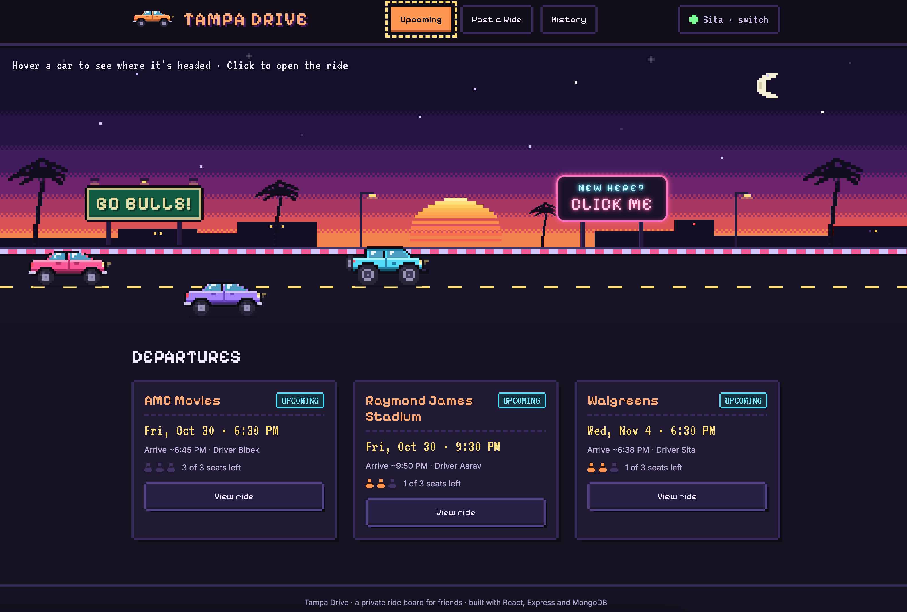
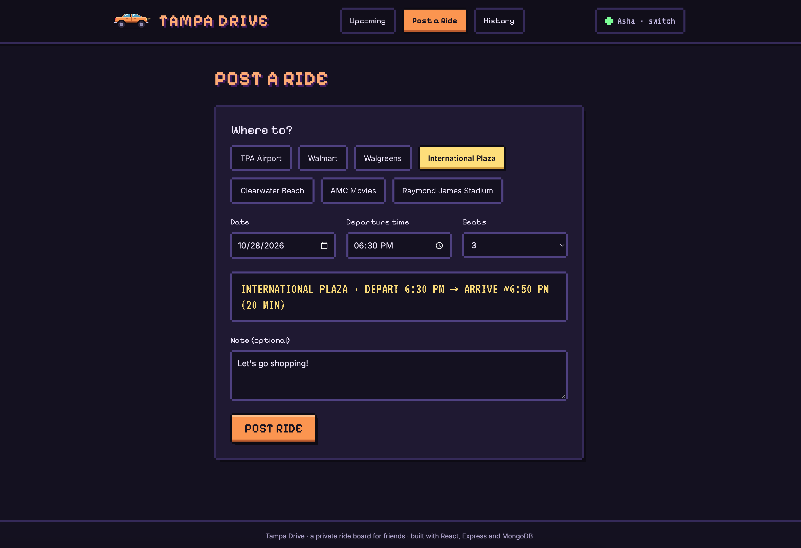
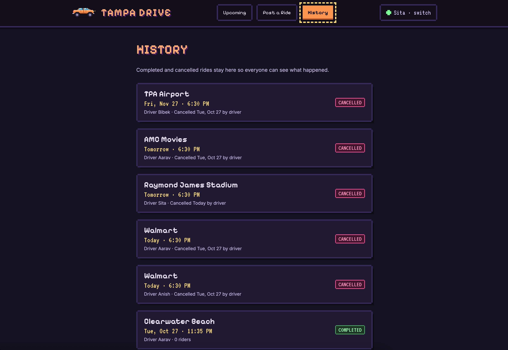

# Tampa Drive

A private ride board for my friends in Tampa, built with the MERN stack (MongoDB, Express.js, React.js, Node.js). Friends who have a car post the trips they're already making, and everyone else grabs a seat.





**Live demo:** _coming soon_

## Why I built this

A lot of my friends are international students without cars. Getting to Walmart, the airport or Clearwater Beach usually meant scrolling through group chats to see who was driving and when. Tampa Drive puts all of that in one place: you see every upcoming ride, how many seats are left, and you join with one click.

## Features

- Post a ride with a destination, date, time, seats and an optional note
- Arrival time is filled in automatically from each destination's usual drive time
- Join or leave a ride; a ride shows **FULL** when the seats run out
- Only the driver can cancel, and cancelled rides move to History instead of disappearing
- History page with completed and cancelled rides
- Private: you need the group's invite code to get in
- Pixel-art sunset road where every upcoming ride is a car you can hover and click
- Works on phones and laptops

## Tech Stack

- Frontend: React.js, React Router
- Backend: Node.js with Express.js (REST API)
- Database: MongoDB Atlas with Mongoose
- Testing: Jest and Supertest
- Styling: hand-written CSS with pixel fonts (Pixelify Sans, VT323)

## Installation

1. Clone the repository:
   ```bash
   git clone https://github.com/umangrazsingh/tampa-drive.git
   ```
2. Go into the project folder:
   ```bash
   cd tampa-drive
   ```
3. Install dependencies (installs both server and client):
   ```bash
   npm install
   ```
4. Create a `.env` file inside the `server` folder:
   ```
   PORT=8000
   MONGO_URL=your_mongodb_connection_string
   INVITE_CODE=pick_any_code
   ```
5. Start the app:
   ```bash
   npm run watch
   ```
   The site opens at http://localhost:3000 and the API runs on http://localhost:8000.

To run the tests: `npm test`. To build the site and serve everything from one server: `npm run deploy`.

## Usage

1. Enter the invite code and pick your name.
2. Hover over a car on the road to see where it's headed, or click it to open the ride.
3. Hit **Join ride** to take a seat, or **Leave ride** if plans change.
4. Use **Post a Ride** to add your own trip. Your car shows up on the road right away.
5. Check **History** for past and cancelled rides.

The friend list lives in `server/data/members.js` and the destinations in `server/data/destinations.js`. Edit them and restart the server.

## How it works

A few things I wanted to get right:

- **No double booking.** Joining a ride checks for a free seat and saves you in the same database update, so two people can't grab the last seat at once.
- **Statuses can't get out of sync.** The database only stores whether a ride is upcoming or cancelled. "Full" and "completed" are worked out every time a ride is sent, from the seats and the departure time.
- **Nothing gets deleted.** Cancelling just changes the status, so History stays accurate.

The API is a small REST API. The main routes are `GET /rides`, `POST /rides`,
`POST /rides/:rideNumber/join`, `POST /rides/:rideNumber/leave` and `DELETE /rides/:rideNumber` (cancel).
Every request needs the invite code in an `x-invite-code` header.

## What's next

- "Need a ride" requests from people without a car
- Google login instead of the invite code
- Real travel times from a maps API
- Notifications when someone joins your ride

## License

This project is licensed under the MIT License - see the [LICENSE](LICENSE) file for details.

## Contact

Umang Raz Singh - [GitHub](https://github.com/umangrazsingh) · [LinkedIn](https://www.linkedin.com/in/umang-raz-singh)

Project Link: https://github.com/umangrazsingh/tampa-drive

## Acknowledgements

- [React](https://react.dev/)
- [Express](https://expressjs.com/)
- [MongoDB Atlas](https://www.mongodb.com/atlas) and [Mongoose](https://mongoosejs.com/)
- [Pixelify Sans](https://fonts.google.com/specimen/Pixelify+Sans) and [VT323](https://fonts.google.com/specimen/VT323) from Google Fonts
